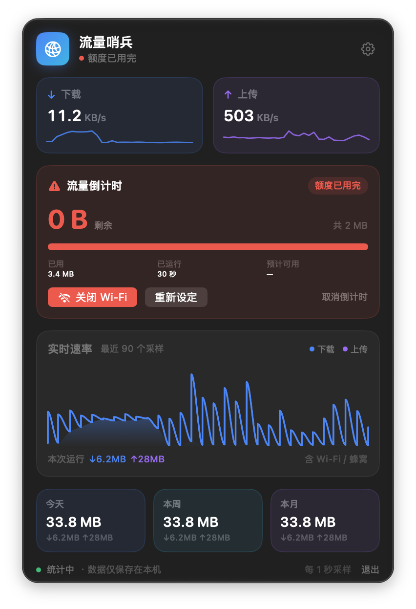
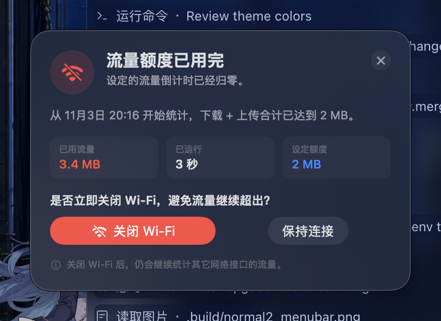
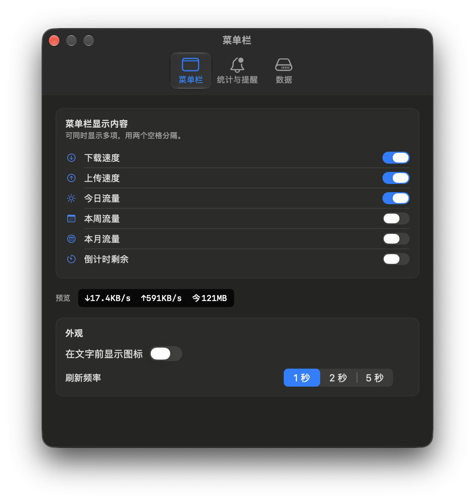

# 流量哨兵 TrafficSentinel

[](LICENSE)
[](https://github.com/ThecangShengdance/TrafficSentinel/releases/latest)

一个原生 SwiftUI 编写的 macOS 菜单栏流量监控 App，专为「用手机卡流量、需要盯住剩余额度」的场景设计。

> 本 README、源码、脚本和截图都位于仓库根目录。


## 功能

- **实时速率**：菜单栏显示当前下载 / 上传速度，仪表盘内有最近 90 个采样的速率曲线。
- **日 / 周 / 月统计**：按自然日、自然周、自然月累计下载 + 上传流量，数据只保存在本机。
- **菜单栏自定义**：可任选下载速度、上传速度、今日、本周、本月、倒计时剩余中的若干项，用两个空格分隔显示；也可以显示一个小图标。
- **流量倒计时（核心功能）**：输入剩余额度（例如 2 GB），点击「开始」后，从此刻起累计下载 + 上传；达到额度时弹出置顶提醒，并询问是否立即关闭 Wi-Fi。
- **额度提醒**：可以选择关闭 Wi-Fi 或保持连接；关闭失败（例如取消管理员授权）会在弹窗内显示原因。
- **开机启动**：可在设置中开启（需要在「系统设置 → 通用 → 登录项」中允许）。
- **本地存储**：`~/Library/Application Support/TrafficSentinel/usage.json`，不会上传任何数据。

## 界面







## 系统要求

- macOS 14.0 或更高版本（已在 macOS 27.2 / Apple Silicon 上验证）
- Xcode 16 或更高版本（工程用 Xcode 27.2 构建）

## 下载

从 [GitHub Releases](https://github.com/ThecangShengdance/TrafficSentinel/releases/latest) 下载 `TrafficSentinel-1.0.0-macOS.zip`，解压后把「流量哨兵.app」拖进「应用程序」即可。

首次打开如果系统提示「无法验证开发者」，请在 Finder 中右键点击 App →「打开」，或到「系统设置 → 隐私与安全性」中允许打开。

> 发布包使用 ad-hoc 签名，未做 Apple 公证，不需要 Apple Developer 账号。

## 构建与运行

### 方式一：用 Xcode 运行

```bash
open TrafficSentinel.xcodeproj
```

1. 在 Xcode 顶部把 scheme 选为 `TrafficSentinel`，运行目标选 `My Mac`。
2. 按 `⌘R` 运行。这是菜单栏 App，没有 Dock 图标；运行后看屏幕右上角菜单栏，应该出现 `↓速率 ↑速率 今日流量`。
3. 如果菜单栏出现两个图标，先退出 `/Applications` 里的旧副本，再运行 Xcode 版本。
4. 想直接拿 Xcode 构建出的 `.app`：按 `⌘B` 构建，然后 `Product → Show Build Folder in Finder`，进入 `Build/Products/Debug/`，里面的 `TrafficSentinel.app` 就是可运行的程序。

### 方式二：命令行构建

```bash
./scripts/build.sh
```

脚本会把 App 输出到 `dist/流量哨兵.app`，并保留构建产物在 `.build/DerivedData/`。这是生成可分发 `.app` 最省事的方式，不需要开发者账号。

### 方式三：下载已打包版本

从 [Releases](https://github.com/ThecangShengdance/TrafficSentinel/releases/latest) 下载 `.zip` 并解压即可；每个 Release 都附带对应的 `SHA256` 校验文件。仓库不提交 `dist/` 构建产物，也可以按方式二自行构建。第一次打开时，如果系统提示「无法验证开发者」，请在 Finder 中右键点击 App →「打开」，或到「系统设置 → 隐私与安全性」中允许打开。

> 工程没有开发者证书，使用 ad-hoc 签名（`CODE_SIGN_IDENTITY="-"`），因此不能做公证，也不依赖 Apple Developer 账号。

### 打包发布文件

```bash
./scripts/package_release.sh
```

脚本会构建 Release 版，并生成 `dist/TrafficSentinel-<版本>-macOS.zip` 与对应的 `.sha256` 文件，可直接上传到 GitHub Releases。

## 使用说明

1. 启动后，菜单栏右侧会出现 `↓速率 ↑速率 今日流量` 的文字（可在设置里增减项）。
2. 点击菜单栏文字打开仪表盘。
3. 在「流量倒计时」卡片里输入额度、选择 MB / GB，点击「开始」。倒计时只统计点击开始之后的流量。
4. 额度用完时会弹出提醒：
   - **关闭 Wi-Fi**：优先通过 CoreWLAN 关闭；如果系统要求授权，会弹出管理员密码窗口。取消授权不会关闭 Wi-Fi。
   - **保持连接**：只关闭提醒，倒计时保持「已用完」状态，不会再次打扰；可在卡片里点「重新设定」重新开始。
5. 点仪表盘右上角齿轮打开设置：
   - **菜单栏**：显示项、是否显示图标、刷新频率（1 / 2 / 5 秒）。
   - **统计与提醒**：数字单位、系统通知、提示音、通知权限、额度提醒预览、登录时启动。
   - **数据**：数据文件位置、在 Finder 中显示、重置今日 / 本周 / 本月 / 全部。

## 统计口径与已知限制

- 流量按 **1000 进制** 统计（1 GB = 1,000,000,000 B），与多数运营商口径一致。
- 统计所有 `en*` 接口（Wi-Fi、有线网络、iPhone USB 共享）以及 `pdp_ip*`（蜂窝），**不统计** loopback、VPN（utun）、AirDrop（awdl）等，避免重复计算。网卡加入或离开时只按同名接口的增量计算，不会把接口历史累计值误算成新流量。
- **App 未运行期间产生的流量不会被记录**。这是本地统计工具，不是系统级常驻驱动。
- App 重启后倒计时会从上次的已用量继续，但 App 退出期间的流量不计入。
- 运营商可能对特定流量（例如定向流量、闲时流量）有不同的计费规则；本 App 统计的是本机网卡收发总量，仅作为额度预警参考。
- 关闭 Wi-Fi 只影响 Wi-Fi 接口。如果正在使用 iPhone USB 共享网络，关闭 Wi-Fi 不会断开 USB 共享。
- 数据只在本机，不提供 iCloud 同步。

## 调试参数（仅 Debug 构建）

```bash
# 打开仪表盘独立窗口
.../TrafficSentinel --open-dashboard

# 打开设置窗口，并指定 tab（0 菜单栏 / 1 统计与提醒 / 2 数据）
.../TrafficSentinel --open-settings --settings-tab 2

# 用 30 MB 额度开始倒计时（用于测试提醒）
.../TrafficSentinel --quota-test 30

# 显示实际样式的额度提醒（不会真的关 Wi-Fi）
.../TrafficSentinel --test-alert-live

# 清空本地统计并退出
.../TrafficSentinel --reset-usage
```

测试时可以把数据目录重定向到工作区，避免污染真实数据：

```bash
TRAFFIC_SENTINEL_SUPPORT_DIR="$PWD/.build/appdata" \
  .build/DerivedData/Build/Products/Debug/TrafficSentinel.app/Contents/MacOS/TrafficSentinel \
  --quota-test 30 --open-dashboard
```

## 工程结构

```
TrafficSentinel.xcodeproj
Sources/       源码
  App/         入口、AppModel（采样 / 倒计时 / 菜单栏文本）
  Core/        字节格式化、网卡计数器、流量账本、设置
  Services/    Wi-Fi 控制、系统通知
  Views/       仪表盘、倒计时卡片、设置、提醒面板、组件
  Assets.xcassets/AppIcon.appiconset
scripts/
  build.sh            命令行构建并打包到 dist/
  package_release.sh  构建 Release 并生成 zip + SHA256
  make_icon.py        重新生成 App 图标（需要 Pillow / numpy）
docs/          截图
CHANGELOG.md   版本变更记录
LICENSE        MIT 许可证
```

`dist/` 和 `.build/` 是本地构建产物，已在 `.gitignore` 中忽略，不会提交到仓库。

## 图标

图标由 `scripts/make_icon.py` 生成：蓝青渐变圆角方块、白色上下箭头、细计时环与玫红额度弧段。重新生成：

```bash
python3 scripts/make_icon.py
```

需要 Python 3 以及 Pillow、numpy（脚本会用 4× 超采样绘制后缩小）。

## 许可证

本项目采用 [MIT License](LICENSE)。Copyright © 2026 ThecangShengdance。
